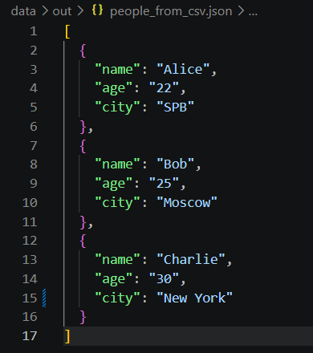
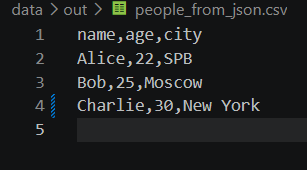
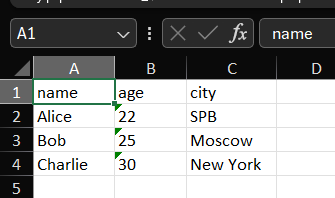

Лабораторная работа №5

Задание А:

```python
import json
import csv
from pathlib import Path


def json_to_csv(json_path: str, csv_path: str) -> None:
    p_in = Path(json_path)
    if not p_in.exists():
        raise FileNotFoundError(f"Файл не найден: {json_path}")

    try:
        with p_in.open(encoding="utf-8") as f:
            data = json.load(f)
    except json.JSONDecodeError:
        raise ValueError("Пустой JSON или неподдерживаемая структура")

    if not data or not isinstance(data, list):
        raise ValueError("Пустой JSON или неподдерживаемая структура")
        
    for item in data:
        if not isinstance(item, dict):
            raise ValueError("JSON должен содержать список словарей")

    keys = list(data[0].keys())
    for item in data:
        for k in item.keys():
            if k not in keys:
                keys.append(k)

    p_out = Path(csv_path)
    p_out.parent.mkdir(parents=True, exist_ok=True)

    with p_out.open("w", newline="", encoding="utf-8") as f:
        writer = csv.DictWriter(f, fieldnames=keys, restval="")
        writer.writeheader()
        writer.writerows(data)


def csv_to_json(csv_path: str, json_path: str) -> None:
    p_in = Path(csv_path)
    if not p_in.exists():
        raise FileNotFoundError(f"Файл не найден: {csv_path}")

    with p_in.open(encoding="utf-8") as f:
        reader = csv.DictReader(f)
        if not reader.fieldnames:
            raise ValueError("CSV не содержит заголовка")
        data = list(reader)

    if not data:
        raise ValueError("Пустой CSV")

    p_out = Path(json_path)
    p_out.parent.mkdir(parents=True, exist_ok=True)

    with p_out.open("w", encoding="utf-8") as f:
        json.dump(data, f, ensure_ascii=False, indent=2)
```

Импортируем json, csv и Path. Превращаем путь в обьект Path и проверяем что файл существует, если нет выбрасываем FileNotFoundError. Открываем файл в ютф 8 и читаем json через json.load (он сразу превращает текст в питоновские списки и словари). Если json битый или пустой, ловим JSONDecodeError и выбрасываем ValueError. Проверяем что данные не пустые и это именно список, потом идем по каждому элементу и проверяем что это словарь. Собираем заголовок: сначала берем ключи из 1 словаря (чтобы сохранить порядок), потом проходим по остальным и добавляем ключи которых еще нет. Создаем родит папки для выходного файла. Открываем файл на запись (newline="" - чтобы не было лишних пустых строк), создаем DictWriter - он пишет словари в csv по названиям колонок, restval="" - если в словаре нет какого то ключа, пишется пустая ячейка. Пишем заголовок и все строки. csv_to_json - обратная функция. Так же проверяем что файл есть. Открываем csv и создаем DictReader - он берет 1 строку как заголовок и каждую следующую строку превращает в словарь (ключ - название колонки, значение - ячейка). Если заголовка нет (fieldnames пустой) выбрасываем ошибку. Превращаем reader в список словарей, если он пустой (есть только заголовок) - тоже ошибка. Создаем родит папки и пишем json через json.dump: ensure_ascii=False - чтобы русские буквы писались нормально, а не как А, indent=2 - красивые отступы. Все значения из csv остаются строками (поэтому возраст "22" в кавычках).


Тест:
```python
python -c "from src.lab05.json_csv import csv_to_json; csv_to_json('data/samples/people.csv', 'data/out/people_from_csv.json')"
python -c "from src.lab05.json_csv import json_to_csv; json_to_csv('data/samples/people.json', 'data/out/people_from_json.csv')"
```



Из people.csv получился json со списком словарей, значения - строки.



Из people.json получился csv с заголовком name,age,city.


Задание В:

```python
import csv
from pathlib import Path
from openpyxl import Workbook
from openpyxl.utils import get_column_letter


def csv_to_xlsx(csv_path: str, xlsx_path: str) -> None:
    """
    Конвертирует CSV в XLSX. Первая строка — заголовок.
    Лист "Sheet1". Автоширина колонок (мин. 8 символов).
    """
    p_in = Path(csv_path)
    if not p_in.exists():
        raise FileNotFoundError(f"Файл не найден: {csv_path}")

    with p_in.open(encoding="utf-8") as f:
        rows = list(csv.reader(f))

    if not rows:
        raise ValueError("Пустой CSV")

    wb = Workbook()
    ws = wb.active
    ws.title = "Sheet1"

    for row in rows:
        ws.append(row)

    for col_idx, col in enumerate(ws.columns, start=1):
        max_len = 0
        for cell in col:
            if cell.value is not None:
                max_len = max(max_len, len(str(cell.value)))
        
        width = max(max_len + 2, 8)
        ws.column_dimensions[get_column_letter(col_idx)].width = width

    p_out = Path(xlsx_path)
    p_out.parent.mkdir(parents=True, exist_ok=True)
    
    wb.save(p_out)
```

Импортируем csv, Path и openpyxl (библиотека для работы с excel, ставится через pip install openpyxl). Workbook - это сама книга excel, get_column_letter - превращает номер колонки в букву (1 -> A, 2 -> B). Проверяем что файл существует, читаем csv обычным reader и сразу превращаем в список строк, если пусто - ошибка. Создаем книгу, берем активный лист и называем его Sheet1. Идем по строкам и добавляем каждую в лист через append (1 строка - заголовок). Дальше делаем автоширину: идем по колонкам (enumerate с 1, потому что в excel колонки с 1), в каждой колонке ищем самое длинное значение. Ширина = длина + 2 (небольшой запас), но не меньше 8. Задаем ширину колонке по ее букве. Создаем родит папки и сохраняем книгу.


Тест:
```python
python -c "from src.lab05.csv_xlsx import csv_to_xlsx; csv_to_xlsx('data/samples/people.csv', 'data/out/people.xlsx')"
```



Создается people.xlsx, лист Sheet1, 1 строка - заголовок, колонки подогнаны по ширине.
