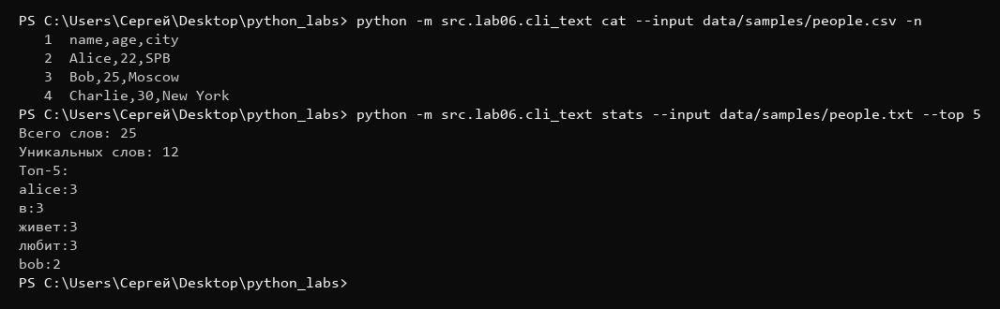
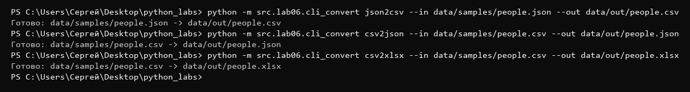
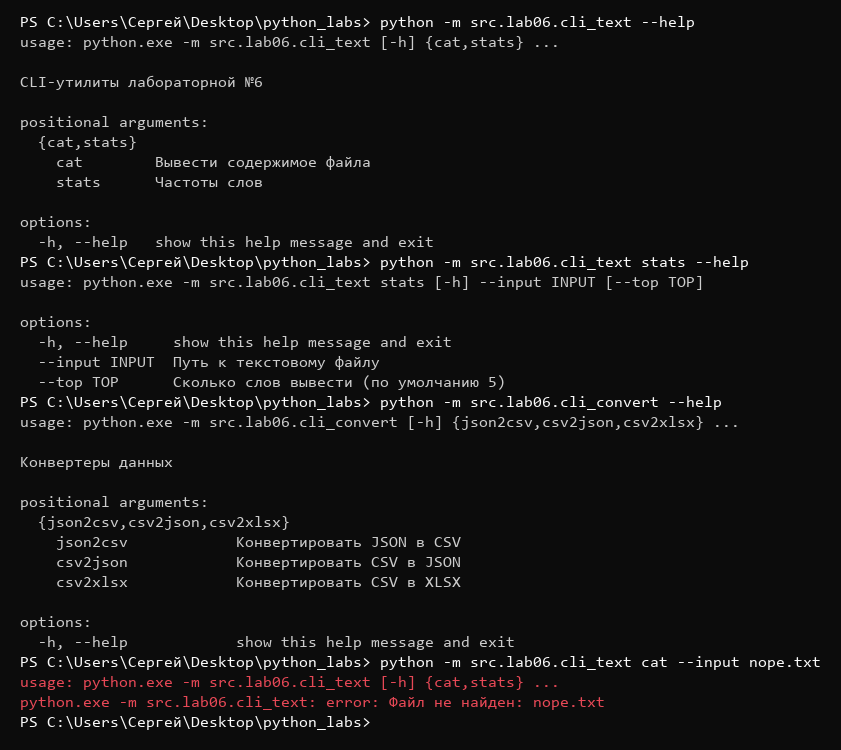

Лабораторная работа №6

Задание А (cli_text):

```python
import argparse
from pathlib import Path

from src.lib.text import normalize, tokenize, count_freq, top_n


def cmd_cat(input_path: str, number: bool) -> None:
    p = Path(input_path)
    if not p.exists():
        raise FileNotFoundError(f"Файл не найден: {input_path}")

    with p.open(encoding="utf-8") as f:
        for i, line in enumerate(f, start=1):
            line = line.rstrip("\n")
            if number:
                print(f"{i:>4}  {line}")
            else:
                print(line)


def cmd_stats(input_path: str, top: int) -> None:
    p = Path(input_path)
    if not p.exists():
        raise FileNotFoundError(f"Файл не найден: {input_path}")

    text = p.read_text(encoding="utf-8")
    tokens = tokenize(normalize(text))
    freq = count_freq(tokens)

    print("Всего слов: " + str(len(tokens)))
    print("Уникальных слов: " + str(len(freq)))
    print(f"Топ-{top}:")
    for word, count in top_n(freq, top):
        print(word + ":" + str(count))


def main():
    parser = argparse.ArgumentParser(description="CLI-утилиты лабораторной №6")
    subparsers = parser.add_subparsers(dest="command")

    cat_parser = subparsers.add_parser("cat", help="Вывести содержимое файла")
    cat_parser.add_argument("--input", required=True, help="Путь к файлу")
    cat_parser.add_argument("-n", action="store_true", help="Нумеровать строки")

    stats_parser = subparsers.add_parser("stats", help="Частоты слов")
    stats_parser.add_argument("--input", required=True, help="Путь к текстовому файлу")
    stats_parser.add_argument("--top", type=int, default=5, help="Сколько слов вывести (по умолчанию 5)")

    args = parser.parse_args()

    if args.command is None:
        parser.error("Не указана подкоманда (cat или stats)")

    try:
        if args.command == "cat":
            cmd_cat(args.input, args.n)
        elif args.command == "stats":
            if args.top <= 0:
                parser.error("--top должен быть больше 0")
            cmd_stats(args.input, args.top)
    except FileNotFoundError as e:
        parser.error(str(e))


if __name__ == "__main__":
    main()
```

Импортируем argparse, Path и функции из lib/text.py которые писали в лаб3 (normalize, tokenize, count_freq, top_n). cmd_cat - проверяем что файл есть, если нет выбрасываем FileNotFoundError. Открываем файл и идем по строкам через enumerate с 1 (чтобы нумерация была с 1, а не с 0), убираем перенос строки в конце через rstrip, если передали флаг -n печатаем номер (выровненный по правому краю на 4 символа) и строку, иначе просто строку. cmd_stats - так же проверяем файл, читаем текст целиком, нормализуем и разбиваем на слова, считаем частоты. Печатаем сколько всего слов, сколько уникальных и топ-N через top_n. В main создаем ArgumentParser и через add_subparsers делаем подкоманды, dest="command" - чтобы потом понять какую подкоманду вызвали. У cat аргумент --input (required=True - обязательный) и флаг -n (action="store_true" - если флаг есть то True, если нет то False). У stats --input и --top (type=int - argparse сам превращает строку в число, default=5). parse_args разбирает командную строку. Если подкоманду не указали или --top <= 0 - выводим ошибку через parser.error (он печатает usage и сообщение и завершает программу). FileNotFoundError ловим и тоже выводим через parser.error, чтобы было понятное сообщение, а не трейсбек.


Задание В (cli_convert):

```python
import argparse

from src.lab05.json_csv import json_to_csv, csv_to_json
from src.lab05.csv_xlsx import csv_to_xlsx


def main():
    parser = argparse.ArgumentParser(description="Конвертеры данных")
    sub = parser.add_subparsers(dest="cmd")

    p1 = sub.add_parser("json2csv", help="Конвертировать JSON в CSV")
    p1.add_argument("--in", dest="input", required=True, help="Входной JSON")
    p1.add_argument("--out", dest="output", required=True, help="Выходной CSV")

    p2 = sub.add_parser("csv2json", help="Конвертировать CSV в JSON")
    p2.add_argument("--in", dest="input", required=True, help="Входной CSV")
    p2.add_argument("--out", dest="output", required=True, help="Выходной JSON")

    p3 = sub.add_parser("csv2xlsx", help="Конвертировать CSV в XLSX")
    p3.add_argument("--in", dest="input", required=True, help="Входной CSV")
    p3.add_argument("--out", dest="output", required=True, help="Выходной XLSX")

    args = parser.parse_args()

    if args.cmd is None:
        parser.error("Не указана подкоманда (json2csv, csv2json или csv2xlsx)")

    try:
        if args.cmd == "json2csv":
            json_to_csv(args.input, args.output)
        elif args.cmd == "csv2json":
            csv_to_json(args.input, args.output)
        elif args.cmd == "csv2xlsx":
            csv_to_xlsx(args.input, args.output)
    except (FileNotFoundError, ValueError) as e:
        parser.error(str(e))

    print(f"Готово: {args.input} -> {args.output}")


if __name__ == "__main__":
    main()
```

Импортируем argparse и функции конвертации из лаб5. Создаем парсер и 3 подкоманды: json2csv, csv2json, csv2xlsx. У каждой аргументы --in и --out, dest="input"/"output" - потому что in это ключевое слово в питоне и args.in написать нельзя. Смотрим какая подкоманда (args.cmd) и вызываем нужную функцию. Ошибки FileNotFoundError (нет файла) и ValueError (пустой/битый файл) ловим и выводим через parser.error. Если все ок печатаем что получилось.


Тест:
```
python -m src.lab06.cli_text cat --input data/samples/people.csv -n
python -m src.lab06.cli_text stats --input data/samples/people.txt --top 5
python -m src.lab06.cli_convert json2csv --in data/samples/people.json --out data/out/people.csv
python -m src.lab06.cli_convert csv2json --in data/samples/people.csv --out data/out/people.json
python -m src.lab06.cli_convert csv2xlsx --in data/samples/people.csv --out data/out/people.xlsx
python -m src.lab06.cli_text --help
python -m src.lab06.cli_text stats --help
python -m src.lab06.cli_convert --help
python -m src.lab06.cli_text cat --input nope.txt
```



cat -n выводит строки с номерами, stats выводит кол-во слов, уникальных и топ-5.



Все 3 конвертации прошли без ошибок, файлы появились в data/out/.



--help работает для каждой подкоманды, при отсутствии файла выводится понятная ошибка.
