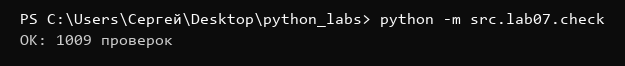
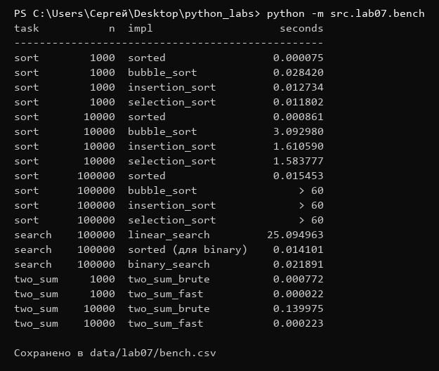
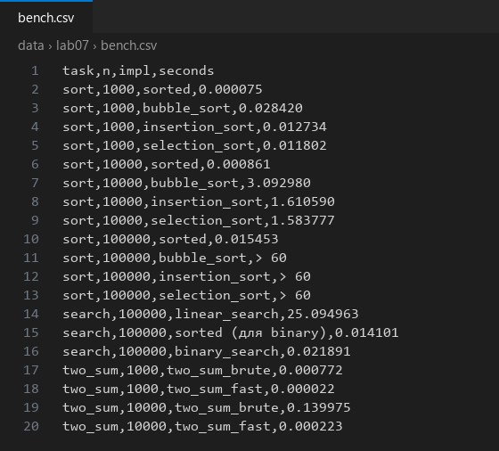

Лабораторная работа №7

Задание А (search.py):

```python
def linear_search(nums: list, x) -> int:
    """Индекс первого вхождения x или -1.

    linear_search([4, 2, 7, 2], 2) -> 1
    linear_search([4, 2, 7, 2], 9) -> -1
    linear_search([], 1) -> -1
    """
    for i in range(len(nums)):
        if nums[i] == x:
            return i
    return -1


def binary_search(sorted_nums: list, x) -> int:
    """Индекс x в отсортированном по возрастанию списке или -1.
    На неотсортированном списке результат не определён.

    binary_search([1, 3, 5, 7], 5) -> 2
    binary_search([1, 3, 5, 7], 4) -> -1
    binary_search([5], 5) -> 0
    binary_search([], 5) -> -1
    """
    lo = 0
    hi = len(sorted_nums) - 1
    while lo <= hi:
        mid = (lo + hi) // 2
        if sorted_nums[mid] == x:
            return mid
        if sorted_nums[mid] < x:
            lo = mid + 1
        else:
            hi = mid - 1
    return -1


def two_sum_brute(nums: list, target) -> tuple[int, int] | None:
    """Пара индексов (i, j), i < j, nums[i] + nums[j] == target, или None.

    two_sum_brute([2, 7, 11, 15], 9) -> (0, 1)
    two_sum_brute([1, 2], 10) -> None
    """
    for i in range(len(nums)):
        for j in range(i + 1, len(nums)):
            if nums[i] + nums[j] == target:
                return (i, j)
    return None


def two_sum_fast(nums: list, target) -> tuple[int, int] | None:
    """То же, что two_sum_brute, но за один проход со словарём."""
    seen = {}
    for j in range(len(nums)):
        need = target - nums[j]
        if need in seen:
            return (seen[need], j)
        seen[nums[j]] = j
    return None
```

linear_search - идем по списку по индексам, как только встретили x возвращаем индекс, если дошли до конца и не нашли возвращаем -1. Поэтому возвращается именно первое вхождение. binary_search - работает только на отсортированном списке. lo и hi - границы куска, где еще может быть x. Берем середину mid, если там x - нашли, если там меньше x то x правее и двигаем lo = mid + 1, если больше то левее и hi = mid - 1. Цикл идет пока lo <= hi, когда они разошлись значит кусок пустой и x нет. Каждый шаг отбрасывает половину, поэтому шагов log n. two_sum_brute - два вложенных цикла, j начинается с i + 1 чтобы не брать один и тот же элемент дважды и чтобы было i < j, это n² шагов. two_sum_fast - словарь seen "значение -> индекс". Для каждого числа считаем сколько не хватает до target (need), если need уже видели раньше - возвращаем его индекс и текущий. Проверка in у словаря работает за O(1) (хеш-таблица, ключи не перебираются), поэтому весь проход O(n). Сначала проверяем, а потом кладем число в словарь - чтобы не сложить число само с собой.


Задание В (sorting.py):

```python
def bubble_sort(nums: list) -> list:
    """Новый список, отсортированный по возрастанию. Исходный не меняется.

    bubble_sort([3, 1, 2]) -> [1, 2, 3]
    bubble_sort([2, 2, 1]) -> [1, 2, 2]
    bubble_sort([]) -> []
    """
    nums = list(nums)
    n = len(nums)
    for i in range(n - 1):
        for j in range(n - 1 - i):
            if nums[j] > nums[j + 1]:
                nums[j], nums[j + 1] = nums[j + 1], nums[j]
    return nums


def insertion_sort(nums: list) -> list:
    """Тот же контракт, что у bubble_sort."""
    nums = list(nums)
    for i in range(1, len(nums)):
        cur = nums[i]
        j = i - 1
        while j >= 0 and nums[j] > cur:
            nums[j + 1] = nums[j]
            j -= 1
        nums[j + 1] = cur
    return nums


def selection_sort(nums: list) -> list:
    """Тот же контракт, что у bubble_sort."""
    nums = list(nums)
    n = len(nums)
    for i in range(n - 1):
        m = i
        for j in range(i + 1, n):
            if nums[j] < nums[m]:
                m = j
        nums[i], nums[m] = nums[m], nums[i]
    return nums
```

Во всех трех сортировках первая строка nums = list(nums) - делаем копию списка, чтобы не менять исходный (если написать nums2 = nums то это будет тот же самый список, просто второе имя). bubble_sort - идем по списку и меняем соседей местами если левый больше правого, за один проход самый большой элемент "всплывает" в конец, поэтому во внутреннем цикле n - 1 - i (последние i элементов уже на месте). insertion_sort - берем очередной элемент cur и сдвигаем все элементы левее, которые больше него, на одну позицию вправо, потом ставим cur в освободившееся место. Слева от i всегда уже отсортированная часть. selection_sort - ищем индекс минимума в оставшейся части (вручную, без min), меняем его с элементом на позиции i. Все три O(n²). Пустой список и список из одного элемента работают, потому что циклы просто ни разу не выполнятся.


Задание С (check.py):

```python
import random

from src.lab07.search import linear_search, binary_search, two_sum_brute, two_sum_fast
from src.lab07.sorting import bubble_sort, insertion_sort, selection_sort


def random_list(max_len: int = 50) -> list:
    n = random.randint(0, max_len)
    return [random.randint(-100, 100) for _ in range(n)]


def check_sorting(fn, trials: int = 100) -> int:
    for _ in range(trials):
        nums = random_list()
        original = list(nums)
        result = fn(nums)
        assert result == sorted(nums), f"{fn.__name__} ошиблась на {nums}: {result}"
        assert nums == original, f"{fn.__name__} изменила исходный список: {original} -> {nums}"
    # отдельно крайние случаи
    for nums in ([], [5], [2, 2, 2], [3, 2, 1], [1, 2, 3]):
        assert fn(nums) == sorted(nums), f"{fn.__name__} ошиблась на {nums}"
    return trials + 5


def check_search(trials: int = 100) -> int:
    count = 0
    for _ in range(trials):
        nums = random_list()
        x = random.randint(-100, 100)
        try:
            expected = nums.index(x)
        except ValueError:
            expected = -1
        got = linear_search(nums, x)
        assert got == expected, f"linear_search({nums}, {x}) = {got}, ожидалось {expected}"
        count += 1

        s = sorted(nums)
        # x которого может не быть, крайние элементы и число вне диапазона
        queries = [x, 1000, -1000]
        if s:
            queries += [s[0], s[-1]]
        for q in queries:
            got = binary_search(s, q)
            if q in s:
                assert got != -1 and s[got] == q, f"binary_search({s}, {q}) = {got}"
            else:
                assert got == -1, f"binary_search({s}, {q}) = {got}, ожидалось -1"
            count += 1
    return count


def check_two_sum(trials: int = 100) -> int:
    for _ in range(trials):
        nums = random_list(30)
        target = random.randint(-200, 200)
        a = two_sum_brute(nums, target)
        b = two_sum_fast(nums, target)
        if a is None or b is None:
            assert a is None and b is None, f"two_sum на {nums}, target={target}: {a} и {b}"
            continue
        for i, j in (a, b):
            assert i < j and nums[i] + nums[j] == target, \
                f"two_sum на {nums}, target={target}: неверная пара ({i}, {j})"
    return trials


if __name__ == "__main__":
    random.seed(42)
    total = 0
    for fn in (bubble_sort, insertion_sort, selection_sort):
        total += check_sorting(fn)
    total += check_search()
    total += check_two_sum()
    print(f"OK: {total} проверок")
```

random_list делает случайный список длиной от 0 до 50 со значениями от -100 до 100, на таком маленьком диапазоне обязательно будут повторы и отрицательные. check_sorting - 100 раз генерируем список, сохраняем копию original, сортируем своей функцией и сравниваем с sorted (эталон). Вторым assert проверяем что исходный список не изменился. Плюс отдельно крайние случаи: пустой, из одного, одинаковые, обратный и уже отсортированный. check_search - linear_search сравниваем с list.index, а так как index при отсутствии кидает ValueError, ловим его и ожидаем -1. binary_search проверяем на отсортированном списке: случайный x (может не быть), число которого точно нет (1000, -1000) и крайние элементы s[0] и s[-1]. Так как при повторах бинарный может вернуть любое вхождение, проверяем не конкретный индекс, а что s[got] == q. check_two_sum - оба способа могут вернуть разные пары (если ответов несколько), поэтому сравниваем не пары, а что обе пары правильные (i < j и сумма равна target) или оба None. В сообщение assert кладем сам список, чтобы можно было воспроизвести ошибку. random.seed(42) - чтобы каждый запуск был одинаковый.


Задание D (bench.py):

```python
import random
import timeit

from src.lab04.io_txt_csv import write_csv
from src.lab07.search import linear_search, binary_search, two_sum_brute, two_sum_fast
from src.lab07.sorting import bubble_sort, insertion_sort, selection_sort

# квадратичные сортировки на 10^5 не запускаем: ~10^10 шагов, это полчаса
QUADRATIC_LIMIT = 10_000


def bench_sorts(n: int) -> list:
    data = [random.randint(-10**6, 10**6) for _ in range(n)]
    rows = []
    t = timeit.timeit(lambda: sorted(data), number=1)
    rows.append(("sort", n, "sorted", t))
    for fn in (bubble_sort, insertion_sort, selection_sort):
        if n > QUADRATIC_LIMIT:
            rows.append(("sort", n, fn.__name__, "> 60"))
            continue
        t = timeit.timeit(lambda: fn(data), number=1)
        rows.append(("sort", n, fn.__name__, t))
    return rows


def bench_search(n: int = 100_000, queries: int = 10_000) -> list:
    data = [random.randint(0, 10 * n) for _ in range(n)]
    qs = [random.randint(0, 10 * n) for _ in range(queries)]
    rows = []

    t = timeit.timeit(lambda: [linear_search(data, q) for q in qs], number=1)
    rows.append(("search", n, "linear_search", t))

    s = []
    t = timeit.timeit(lambda: s.extend(sorted(data)), number=1)
    rows.append(("search", n, "sorted (для binary)", t))

    t = timeit.timeit(lambda: [binary_search(s, q) for q in qs], number=1)
    rows.append(("search", n, "binary_search", t))
    return rows


def bench_two_sum(n: int) -> list:
    data = random.sample(range(-10 * n, 10 * n), n)
    # ответ гарантированно есть - сумма двух последних
    target = data[-2] + data[-1]
    rows = []
    for fn in (two_sum_brute, two_sum_fast):
        t = timeit.timeit(lambda: fn(data, target), number=1)
        rows.append(("two_sum", n, fn.__name__, t))
    return rows


def fmt(seconds) -> str:
    if isinstance(seconds, str):
        return seconds
    return f"{seconds:.6f}"


def main():
    random.seed(42)
    rows = []
    for n in (1_000, 10_000, 100_000):
        rows += bench_sorts(n)
    rows += bench_search()
    for n in (1_000, 10_000):
        rows += bench_two_sum(n)

    rows = [(task, n, impl, fmt(t)) for task, n, impl, t in rows]

    print(f"{'task':<8} {'n':>7}  {'impl':<20} {'seconds':>10}")
    print("-" * 49)
    for task, n, impl, t in rows:
        print(f"{task:<8} {n:>7}  {impl:<20} {t:>10}")

    write_csv(rows, "data/lab07/bench.csv", header=("task", "n", "impl", "seconds"))
    print("\nСохранено в data/lab07/bench.csv")


if __name__ == "__main__":
    main()
```

random.seed(42) в начале - результаты повторяются. В bench_sorts данные генерируются один раз и одни и те же подаются всем сортировкам, иначе сравнение нечестное. timeit.timeit(lambda: ..., number=1) - запускает функцию один раз и возвращает время в секундах. Квадратичные сортировки на n = 100 000 не запускаем: это ~10¹⁰ шагов, по замеру на 10 000 пузырек занял 3 секунды, значит на 100 000 было бы ~300 секунд, поэтому в таблице пишем "> 60". bench_search - список из 100 000 и 10 000 случайных запросов, для бинарного отдельной строкой считаем время сортировки (без нее бинарный работать не может). bench_two_sum - random.sample дает разные числа, target = сумма двух последних, так что ответ гарантированно есть. В конце печатаем таблицу с выравниванием через f-строки (< - по левому краю, > - по правому) и сохраняем в data/lab07/bench.csv через write_csv из лаб4.


Тест:
```
python -m src.lab07.check
python -m src.lab07.bench
```



check.py прошел все проверки.





Вывод бенчмарка:

```
task           n  impl                    seconds
-------------------------------------------------
sort        1000  sorted                 0.000075
sort        1000  bubble_sort            0.028420
sort        1000  insertion_sort         0.012734
sort        1000  selection_sort         0.011802
sort       10000  sorted                 0.000861
sort       10000  bubble_sort            3.092980
sort       10000  insertion_sort         1.610590
sort       10000  selection_sort         1.583777
sort      100000  sorted                 0.015453
sort      100000  bubble_sort                > 60
sort      100000  insertion_sort             > 60
sort      100000  selection_sort             > 60
search    100000  linear_search         25.094963
search    100000  sorted (для binary)    0.014101
search    100000  binary_search          0.021891
two_sum     1000  two_sum_brute          0.000772
two_sum     1000  two_sum_fast           0.000022
two_sum    10000  two_sum_brute          0.139975
two_sum    10000  two_sum_fast           0.000223
```


Выводы:

Пузырек при росте n в 10 раз (с 1 000 до 10 000) замедлился с 0.028 до 3.09 секунды, то есть примерно в 109 раз. Это потому что он O(n²): количество сравнений растет как квадрат n, 10² = 100. Вставки и выбор тоже квадратичные и замедлились примерно так же. sorted (Timsort) работает за O(n log n), при росте n в 10 раз шагов становится в 10 · (log 10⁴ / log 10³) ≈ 13 раз больше, и по замеру он замедлился в ~11 раз (с 1 000 до 10 000) и в ~18 раз (с 10 000 до 100 000). К тому же sorted написан на C, поэтому даже на 1 000 он в ~400 раз быстрее пузырька.

Бинарный поиск без сортировки бесполезен - он опирается на то, что слева от середины все меньше, а справа больше, на неотсортированном списке он просто отбросит половину, где был x, и вернет -1. Сортировка стоит O(n log n), это дороже одного линейного поиска O(n), поэтому ради одного запроса сортировать нет смысла. Но она окупается когда запросов много: по замеру 10 000 линейных поисков заняли 25 секунд (~2.5 мс на запрос), а сортировка 0.014 с + 10 000 бинарных 0.022 с. Сортировка стоит примерно как 6 линейных запросов, значит уже начиная с ~6 запросов выгоднее отсортировать один раз и искать бинарным. Так же Two Sum: перебор пар на 10 000 в ~600 раз медленнее чем через словарь.

check.py делает 1009 проверок: по 105 на каждую сортировку (100 случайных + 5 крайних), 400 на поиск и 100 на two_sum. Расхождений в итоговом коде не нашел. Чтобы убедиться что check.py вообще ловит ошибки, я специально сломал пузырек (во внутреннем цикле range(n - 2 - i) вместо range(n - 1 - i), то есть последняя пара не сравнивается) и check сразу упал на первом же случайном списке:

```
AssertionError: bubble_sort ошиблась на [-72, -94, 89, ...]: [-99, -94, ..., 94, -13]
```

видно что -13 остался в конце, вернул правильную границу и проверка снова прошла. Еще важный момент в check_search: индекс бинарного нельзя сравнивать с list.index, на списке с повторами бинарный может вернуть другое вхождение и проверка упала бы зря, поэтому проверяется s[got] == q.
