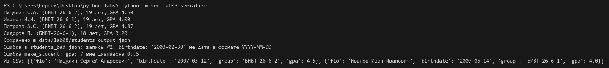
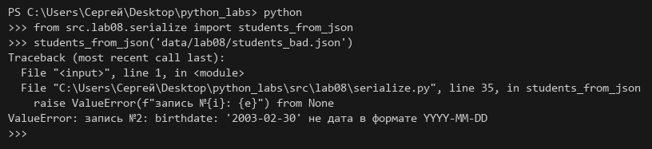
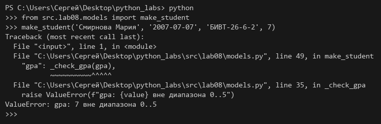

Лабораторная работа №8

Задание А (models.py):

```python
from datetime import date

STUDENT_FIELDS = ("fio", "birthdate", "group", "gpa")


def _check_text(name: str, value) -> str:
    if not isinstance(value, str):
        raise ValueError(f"{name}: ожидалась строка, получено {type(value).__name__}")
    value = value.strip()
    if not value:
        raise ValueError(f"{name}: пустая строка")
    return value


def _check_birthdate(value) -> str:
    if not isinstance(value, str):
        raise ValueError(f"birthdate: ожидалась строка, получено {type(value).__name__}")
    try:
        d = date.fromisoformat(value)
    except ValueError:
        raise ValueError(f"birthdate: '{value}' не дата в формате YYYY-MM-DD") from None
    # fromisoformat в новых версиях понимает и 20070514, нам нужен строго YYYY-MM-DD
    if d.isoformat() != value:
        raise ValueError(f"birthdate: '{value}' не дата в формате YYYY-MM-DD")
    if d > date.today():
        raise ValueError(f"birthdate: '{value}' дата в будущем")
    return value


def _check_gpa(value) -> float:
    # bool это подкласс int, True прошел бы как 1, поэтому отсекаем отдельно
    if isinstance(value, bool) or not isinstance(value, (int, float)):
        raise ValueError(f"gpa: ожидалось число, получено {type(value).__name__}")
    if not (0 <= value <= 5):
        raise ValueError(f"gpa: {value} вне диапазона 0..5")
    return float(value)


def make_student(fio, birthdate, group, gpa) -> dict:
    """Собрать запись студента, проверив каждое поле.

    make_student("Иванов Иван Иванович", "2007-05-14", "БИВТ-26-6-1", 4.3)
    -> {"fio": "Иванов Иван Иванович", "birthdate": "2007-05-14", "group": "БИВТ-26-6-1", "gpa": 4.3}
    """
    return {
        "fio": _check_text("fio", fio),
        "birthdate": _check_birthdate(birthdate),
        "group": _check_text("group", group),
        "gpa": _check_gpa(gpa),
    }


def validate_student(rec: dict) -> None:
    """Проверить готовую запись: набор ключей и значения. При ошибке ValueError."""
    if not isinstance(rec, dict):
        raise ValueError(f"запись должна быть словарем, получено {type(rec).__name__}")
    if set(rec) != set(STUDENT_FIELDS):
        missing = [k for k in STUDENT_FIELDS if k not in rec]
        extra = [str(k) for k in rec if k not in STUDENT_FIELDS]
        msg = []
        if missing:
            msg.append("нет полей: " + ", ".join(missing))
        if extra:
            msg.append("лишние поля: " + ", ".join(extra))
        raise ValueError("; ".join(msg))
    make_student(rec["fio"], rec["birthdate"], rec["group"], rec["gpa"])


def student_age(rec: dict, today=None) -> int:
    """Полных лет на дату today (по умолчанию сегодня).

    student_age({..."birthdate": "2007-09-20"...}, date(2026, 9, 19)) -> 18
    student_age({..."birthdate": "2007-09-20"...}, date(2026, 9, 20)) -> 19
    """
    b = date.fromisoformat(rec["birthdate"])
    if today is None:
        today = date.today()
    age = today.year - b.year
    # если день рождения в этом году еще не наступил - минус год
    if (today.month, today.day) < (b.month, b.day):
        age -= 1
    return age


def _years_word(n: int) -> str:
    if n % 10 == 1 and n % 100 != 11:
        return "год"
    if 2 <= n % 10 <= 4 and not (12 <= n % 100 <= 14):
        return "года"
    return "лет"


def _short_fio(fio: str) -> str:
    # как в лаб1: от имени и отчества берем первые буквы, фамилию оставляем целиком
    parts = fio.split()
    initials = ""
    for p in parts[1:]:
        initials = initials + p[0].upper() + "."
    if initials:
        return parts[0] + " " + initials
    return parts[0]


def format_student(rec: dict, today=None) -> str:
    """Иванов И.И. (БИВТ-26-6-1), 19 лет, GPA 4.30"""
    age = student_age(rec, today)
    return f"{_short_fio(rec['fio'])} ({rec['group']}), {age} {_years_word(age)}, GPA {rec['gpa']:.2f}"


def student_to_dict(rec: dict) -> dict:
    """Копия записи для сериализации (новый словарь, а не rec)."""
    validate_student(rec)
    return {k: rec[k] for k in STUDENT_FIELDS}


def student_from_dict(d: dict) -> dict:
    """Десериализация: ровно нужные ключи, gpa -> float, валидация."""
    if not isinstance(d, dict):
        raise ValueError(f"запись должна быть словарем, получено {type(d).__name__}")
    missing = [k for k in STUDENT_FIELDS if k not in d]
    if missing:
        raise ValueError("нет полей: " + ", ".join(missing))
    gpa = d["gpa"]
    # из CSV gpa приходит строкой - здесь это и лечится
    if isinstance(gpa, str):
        try:
            gpa = float(gpa.replace(",", "."))
        except ValueError:
            raise ValueError(f"gpa: '{d['gpa']}' не число") from None
    return make_student(d["fio"], d["birthdate"], d["group"], gpa)


def update_student(rec: dict, **fields) -> dict:
    """ Новая запись с измененными полями, исходная не меняется.

    s2 = update_student(s1, gpa=4.8); s1["gpa"] - прежнее значение
    """
    for k in fields:
        if k not in STUDENT_FIELDS:
            raise KeyError(f"неизвестное поле: {k}")
    new = dict(rec)
    new.update(fields)
    validate_student(new)
    return make_student(new["fio"], new["birthdate"], new["group"], new["gpa"])
```

Запись Student - это обычный словарь, у которого всегда ровно 4 ключа из константы STUDENT_FIELDS = ("fio", "birthdate", "group", "gpa"):


Каждое поле проверяет своя маленькая функция (_check_text, _check_birthdate, _check_gpa), при ошибке она кидает ValueError, в сообщении сначала имя поля, потом причина, например "gpa: 7 вне диапазона 0..5". Никаких print("warning") - если данные плохие, программа падает, а не работает дальше с мусором. make_student - конструктор: прогоняет все 4 поля через проверки и собирает словарь, fio и group заодно очищаются от пробелов по краям. Дату проверяю через date.fromisoformat, он сам понимает что 2003-02-30 не существует (day is out of range for month). Свою ошибку кидаю через raise ... from None, чтобы в трейсбеке была одна понятная ошибка, а не цепочка "During handling of the above exception, another exception occurred". Дополнительно сравниваю d.isoformat() с исходной строкой, потому что в новых версиях Python fromisoformat принимает и "20070514", а нам нужен строго формат с дефисами. В gpa отдельно отсекаю bool, потому что bool это подкласс int и True прошел бы как 1. validate_student проверяет уже готовый словарь: сначала set(rec) == set(STUDENT_FIELDS) (если нет - пишет каких полей не хватает и какие лишние), потом значения через тот же make_student, чтобы правила проверки были в одном месте. student_age - полных лет: разница годов, и если в этом году день рождения еще не наступил ((месяц, день) сегодня меньше чем (месяц, день) рождения) - минус один. Поэтому родившийся 2007-09-20 на 2026-09-19 имеет 18, а на 2026-09-20 уже 19. today можно передать явно, это нужно чтобы результат не зависел от дня запуска. format_student - красивый вывод "Иванов И.И. (БИВТ-26-6-1), 19 лет, GPA 4.30": инициалы как в лаб1 (первая буква каждого слова), только фамилия остается целиком, слово "год/года/лет" подбирается по числу, gpa через :.2f. student_to_dict возвращает новый словарь {k: rec[k] for k in STUDENT_FIELDS}, а не сам rec, иначе изменение копии поменяло бы исходную запись (два имени - один объект, как в лаб3). student_from_dict - обратное преобразование: берет из словаря только нужные ключи (лишние просто игнорирует), если gpa строка - переводит во float (так приходит из CSV), и прогоняет все через make_student.

★ update_student(rec, **fields) - сначала проверяет что все ключи из STUDENT_FIELDS (иначе KeyError), делает копию dict(rec), меняет в копии поля и валидирует ее. Исходная запись не меняется:

```python
>>> s1 = make_student("Иванов Иван Иванович", "2007-09-20", "БИВТ-26-6-1", 4)
>>> s2 = update_student(s1, gpa=4.8)
>>> s1["gpa"], s2["gpa"]
(4.0, 4.8)
>>> update_student(s1, age=3)
KeyError: 'неизвестное поле: age'
```


Задание В (serialize.py):

```python
import csv
import json
from pathlib import Path

from src.lab08.models import STUDENT_FIELDS, student_from_dict, student_to_dict


def students_to_json(students: list, path) -> None:
    """Сохранить список записей в JSON-массив (ensure_ascii=False, indent=2)."""
    data = [student_to_dict(s) for s in students]
    p = Path(path)
    p.parent.mkdir(parents=True, exist_ok=True)
    with p.open("w", encoding="utf-8") as f:
        json.dump(data, f, ensure_ascii=False, indent=2)


def students_from_json(path) -> list:
    """Прочитать JSON-массив записей. Политика strict: первая битая запись -> ValueError."""
    p = Path(path)
    if not p.exists():
        raise FileNotFoundError(f"Файл не найден: {path}")
    try:
        with p.open(encoding="utf-8") as f:
            data = json.load(f)
    except json.JSONDecodeError as e:
        raise ValueError(f"{path}: битый JSON ({e})") from None
    if not isinstance(data, list):
        raise ValueError(f"{path}: ожидался JSON-массив")

    students = []
    for i, item in enumerate(data, start=1):
        try:
            students.append(student_from_dict(item))
        except ValueError as e:
            raise ValueError(f"запись №{i}: {e}") from None
    return students


def students_from_csv(path) -> list:
    """ Чтение записей из CSV (заголовок fio,birthdate,group,gpa). Политика та же - strict."""
    p = Path(path)
    if not p.exists():
        raise FileNotFoundError(f"Файл не найден: {path}")
    with p.open(encoding="utf-8", newline="") as f:
        reader = csv.DictReader(f)
        if reader.fieldnames is None or tuple(reader.fieldnames) != STUDENT_FIELDS:
            raise ValueError(f"{path}: заголовок должен быть {','.join(STUDENT_FIELDS)}")
        students = []
        # start=2 - первая строка файла это заголовок
        for i, row in enumerate(reader, start=2):
            try:
                students.append(student_from_dict(row))
            except ValueError as e:
                raise ValueError(f"строка {i}: {e}") from None
    return students


if __name__ == "__main__":
    from src.lab08.models import format_student

    students = students_from_json("data/lab08/students_input.json")
    for s in students:
        print(format_student(s))
    students_to_json(students, "data/lab08/students_output.json")
    print("Сохранено в data/lab08/students_output.json")

    try:
        students_from_json("data/lab08/students_bad.json")
    except ValueError as e:
        print("Ошибка в students_bad.json:", e)

    from src.lab08.models import make_student
    try:
        make_student("Смирнова Мария", "2007-07-07", "БИВТ-26-6-2", 7)
    except ValueError as e:
        print("Ошибка make_student:", e)

    print("Из CSV:", students_from_csv("data/lab08/students_input.csv"))
```

students_to_json - каждую запись превращает в копию через student_to_dict (заодно валидирует, битую запись в файл не запишем), создает папки и сохраняет через json.dump с ensure_ascii=False (чтобы русские буквы были буквами, а не И) и indent=2. students_from_json - читает файл, если JSON битый или в нем не массив - ValueError, потом каждую запись прогоняет через student_from_dict.

Политика обработки битых записей - strict: на первой же битой записи чтение останавливается и кидается ValueError с номером записи (с 1) и причиной, например "запись №2: birthdate: '2003-02-30' не дата в формате YYYY-MM-DD". Выбрал strict, потому что если в файле есть мусор, лучше сразу об этом узнать и исправить файл, чем потом работать с половиной данных и не заметить что кого-то потеряли.

★ students_from_csv - читает через csv.DictReader, заголовок должен быть ровно fio,birthdate,group,gpa. Из CSV все значения приходят строками, в том числе gpa = "4.5". Лечится это в одном месте - в student_from_dict из models.py: если gpa строка, он делает float(gpa) (запятую тоже заменяет на точку). Поэтому и JSON, и CSV, и потом лаб9 используют одну и ту же функцию и строка в gpa никуда дальше не проходит. Политика тоже strict, номер в ошибке - это номер строки файла (первая строка заголовок).


Файлы данных:

data/lab08/students_input.json - вход (у Иванова gpa целое 4, у Сидорова пробелы вокруг ФИО):

```json
[
  {"fio": "Пищулин Сергей Андреевич", "birthdate": "2007-03-12", "group": "БИВТ-26-6-2", "gpa": 4.5},
  {"fio": "Иванов Иван Иванович", "birthdate": "2007-05-14", "group": "БИВТ-26-6-1", "gpa": 4},
  {"fio": "Петрова Анна Сергеевна", "birthdate": "2006-11-30", "group": "БИВТ-26-6-2", "gpa": 4.87},
  {"fio": "  Сидоров Петр  ", "birthdate": "2008-01-01", "group": "БИВТ-26-6-1", "gpa": 3.2}
]
```

data/lab08/students_output.json - выход (gpa стал 4.0, пробелы убраны):

```json
[
  {
    "fio": "Пищулин Сергей Андреевич",
    "birthdate": "2007-03-12",
    "group": "БИВТ-26-6-2",
    "gpa": 4.5
  },
  {
    "fio": "Иванов Иван Иванович",
    "birthdate": "2007-05-14",
    "group": "БИВТ-26-6-1",
    "gpa": 4.0
  },
  {
    "fio": "Петрова Анна Сергеевна",
    "birthdate": "2006-11-30",
    "group": "БИВТ-26-6-2",
    "gpa": 4.87
  },
  {
    "fio": "Сидоров Петр",
    "birthdate": "2008-01-01",
    "group": "БИВТ-26-6-1",
    "gpa": 3.2
  }
]
```

data/lab08/students_bad.json - вторая запись с несуществующей датой 2003-02-30, третья с gpa = 7:

```json
[
  {"fio": "Иванов Иван Иванович", "birthdate": "2007-05-14", "group": "БИВТ-26-6-1", "gpa": 4.3},
  {"fio": "Кузнецов Олег Павлович", "birthdate": "2003-02-30", "group": "БИВТ-26-6-1", "gpa": 4.1},
  {"fio": "Смирнова Мария", "birthdate": "2007-07-07", "group": "БИВТ-26-6-2", "gpa": 7}
]
```


Тест:
```
python -m src.lab08.serialize
```

```
Пищулин С.А. (БИВТ-26-6-2), 19 лет, GPA 4.50
Иванов И.И. (БИВТ-26-6-1), 19 лет, GPA 4.00
Петрова А.С. (БИВТ-26-6-2), 19 лет, GPA 4.87
Сидоров П. (БИВТ-26-6-1), 18 лет, GPA 3.20
Сохранено в data/lab08/students_output.json
Ошибка в students_bad.json: запись №2: birthdate: '2003-02-30' не дата в формате YYYY-MM-DD
Ошибка make_student: gpa: 7 вне диапазона 0..5
Из CSV: [{'fio': 'Пищулин Сергей Андреевич', 'birthdate': '2007-03-12', 'group': 'БИВТ-26-6-2', 'gpa': 4.5}, {'fio': 'Иванов Иван Иванович', 'birthdate': '2007-05-14', 'group': 'БИВТ-26-6-1', 'gpa': 4.0}]
```



Корректные записи туда-обратно: прочитали students_input.json, вывели через format_student, сохранили в students_output.json.



Запись с неверной датой 2003-02-30 - students_from_json падает на записи №2.



Запись с gpa = 7 - make_student кидает ValueError.


Выводы:

Модель данных можно описать и без классов: фиксированный набор ключей в константе, одна функция-конструктор, которая проверяет данные, и функции, которые принимают запись первым аргументом. Все проверки собраны в make_student, остальные функции (validate_student, student_from_dict, update_student) просто ее вызывают, поэтому правило "gpa от 0 до 5" написано один раз. Регулярки для даты недостаточно, 2003-02-30 по формату правильная, а такой даты нет, поэтому разбираю через date.fromisoformat. При сериализации важно возвращать копию, а не сам словарь, и не забывать валидацию на входе: JSON и CSV могут прийти от кого угодно, а из CSV вообще все приходит строками.
