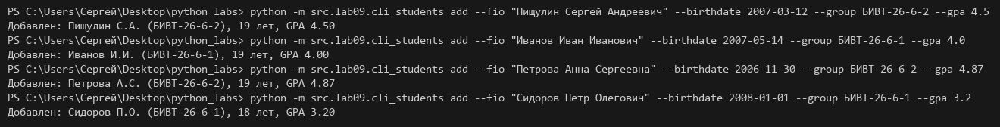
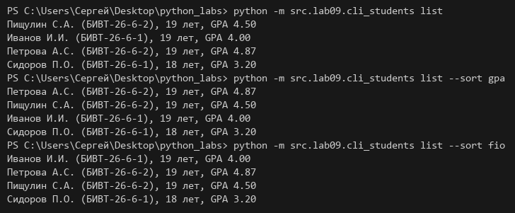
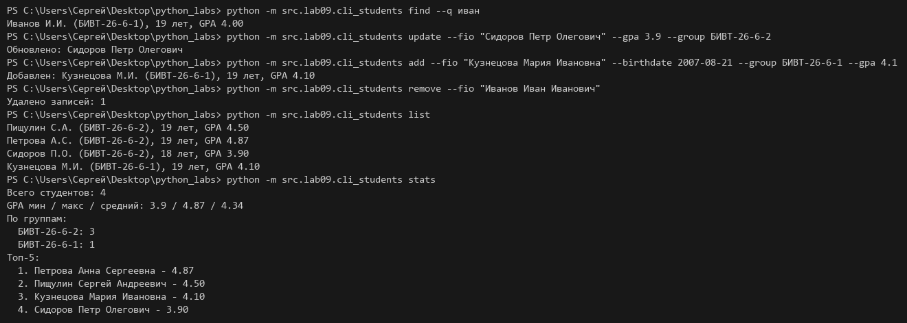
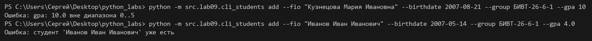

Лабораторная работа №9

Задание А (group.py):

```python
import csv
from pathlib import Path

from src.lab08.models import STUDENT_FIELDS, student_from_dict, validate_student

HEADER = STUDENT_FIELDS


def ensure_storage(path) -> None:
    """Создать файл с одной строкой-заголовком, если его еще нет (вместе с папками)."""
    p = Path(path)
    if p.exists():
        return
    p.parent.mkdir(parents=True, exist_ok=True)
    with p.open("w", newline="", encoding="utf-8") as f:
        csv.writer(f).writerow(HEADER)


def load_students(path) -> list:
    """Все записи из CSV, каждая строка через student_from_dict."""
    ensure_storage(path)
    with Path(path).open(encoding="utf-8", newline="") as f:
        reader = csv.DictReader(f)
        if reader.fieldnames is None:
            raise ValueError(f"{path}: нет строки-заголовка")
        if tuple(reader.fieldnames) != HEADER:
            raise ValueError(
                f"{path}: заголовок {','.join(reader.fieldnames)}, ожидалось {','.join(HEADER)}"
            )
        students = []
        # start=2 - первая строка файла это заголовок
        for i, row in enumerate(reader, start=2):
            # лишние значения в строке DictReader складывает под ключ None
            if None in row:
                raise ValueError(f"{path}, строка {i}: лишние колонки")
            try:
                students.append(student_from_dict(row))
            except ValueError as e:
                raise ValueError(f"{path}, строка {i}: {e}") from None
    return students


def save_students(path, students: list) -> None:
    """Перезаписать файл целиком."""
    for s in students:
        validate_student(s)
    p = Path(path)
    p.parent.mkdir(parents=True, exist_ok=True)
    with p.open("w", newline="", encoding="utf-8") as f:
        writer = csv.DictWriter(f, fieldnames=HEADER)
        writer.writeheader()
        writer.writerows(students)


def add_student(path, student: dict) -> None:
    """Проверить запись и дописать в конец. ★ Дубликат по fio - ValueError."""
    validate_student(student)
    students = load_students(path)
    for s in students:
        if s["fio"] == student["fio"]:
            raise ValueError(f"студент '{student['fio']}' уже есть")
    students.append(dict(student))
    save_students(path, students)


def list_students(path, sort_by=None) -> list:
    """Все студенты, sort_by: None, "fio" или "gpa" (по убыванию)."""
    students = load_students(path)
    if sort_by is None:
        return students
    if sort_by == "fio":
        return sorted(students, key=lambda s: s["fio"].lower())
    if sort_by == "gpa":
        return sorted(students, key=lambda s: s["gpa"], reverse=True)
    raise ValueError(f"неизвестное поле сортировки: {sort_by} (можно fio или gpa)")


def find_students(path, substr: str) -> list:
    """Записи, у которых substr входит в fio без учета регистра."""
    q = substr.casefold()
    return [s for s in load_students(path) if q in s["fio"].casefold()]


def remove_student(path, fio: str) -> int:
    """Удалить все записи с таким fio, вернуть сколько удалено."""
    students = load_students(path)
    left = [s for s in students if s["fio"] != fio]
    removed = len(students) - len(left)
    if removed:
        save_students(path, left)
    return removed


def update_student(path, fio: str, **fields) -> bool:
    """Обновить поля первой записи с таким fio. True если нашли, иначе False."""
    for k in fields:
        if k not in HEADER:
            raise KeyError(f"неизвестное поле: {k}")
    students = load_students(path)
    for i, s in enumerate(students):
        if s["fio"] == fio:
            new = dict(s)
            new.update(fields)
            # прогоняем через student_from_dict: gpa может прийти строкой
            students[i] = student_from_dict(new)
            save_students(path, students)
            return True
    return False


def stats(path) -> dict:
    """★ Статистика по студентам."""
    students = load_students(path)
    if not students:
        return {"count": 0, "min_gpa": None, "max_gpa": None, "avg_gpa": None,
                "groups": {}, "top_5_students": []}
    gpas = [s["gpa"] for s in students]
    groups = {}
    for s in students:
        groups[s["group"]] = groups.get(s["group"], 0) + 1
    top = sorted(students, key=lambda s: s["gpa"], reverse=True)[:5]
    return {
        "count": len(students),
        "min_gpa": min(gpas),
        "max_gpa": max(gpas),
        "avg_gpa": round(sum(gpas) / len(gpas), 2),
        "groups": groups,
        "top_5_students": [{"fio": s["fio"], "gpa": s["gpa"]} for s in top],
    }
```

Все функции получают путь к CSV первым аргументом - это и есть общее состояние группы функций, ничего не "запоминается" внутри. Запись студента берется из лаб8 (STUDENT_FIELDS, student_from_dict, validate_student). ensure_storage - если файла нет, создает папки и файл с одной строкой-заголовком fio,birthdate,group,gpa, если есть - ничего не делает. load_students - вызывает ensure_storage (чтобы на пустой базе не падать, а вернуть []), читает через csv.DictReader. Если заголовка нет или он не такой - ValueError. Если в строке значений больше чем колонок, DictReader кладет лишнее под ключ None, по нему ловлю лишние колонки. Каждую строку прогоняю через student_from_dict - там gpa из строки "4.3" становится float 4.3, без этого сортировка по gpa сравнивала бы строки и "10.0" оказалось бы меньше "4.3". В ошибке пишу номер строки файла (start=2, первая строка заголовок). save_students - перезаписывает файл целиком через csv.DictWriter с fieldnames=STUDENT_FIELDS, newline="" (иначе на Windows между строками появляются пустые) и encoding="utf-8", перед записью каждую запись валидирует.

CSV не умеет менять одну строку на месте, поэтому все изменяющие операции устроены одинаково: load_students -> поменять список в памяти -> save_students. add_student - validate_student, загрузить, ★ если студент с таким fio уже есть - ValueError (запрет дубликатов), дописать копию в конец, сохранить. list_students - sort_by None (как в файле), "fio" (по алфавиту без учета регистра) или "gpa" (по убыванию, лучшие сверху), через sorted(..., key=lambda ...), все остальное - ValueError. find_students - подстрока в fio без учета регистра, обе строки привожу через casefold. remove_student - удаляет все записи с таким fio: оставляю в новом списке всех у кого fio другой, разница длин - сколько удалили. Удалять через pop в цикле по тому же списку нельзя - индексы сдвигаются и следующий элемент пропускается. Если никого не удалили - файл не перезаписываю. update_student - неизвестный ключ в fields сразу KeyError, находит первую запись с таким fio, делает копию, меняет поля и прогоняет через student_from_dict (валидация результата), если новая запись плохая - падает и файл не меняется. Возвращает True если нашел, False если нет.

★ stats - считает count, min/max/avg gpa, сколько студентов в каждой группе (словарь group -> количество через get(g, 0) + 1) и топ-5 по gpa (sorted по убыванию и срез [:5]). На пустой базе возвращает count 0 и None вместо gpa, чтобы не делить на ноль.


Задание В (cli_students.py):

```python
import argparse
import sys

from src.lab08.models import format_student, make_student
from src.lab09.group import (
    add_student,
    find_students,
    list_students,
    remove_student,
    stats,
    update_student,
)

DEFAULT_DB = "data/lab09/students.csv"


def print_students(students: list) -> None:
    if not students:
        print("(пусто)")
    for s in students:
        print(format_student(s))


def main(argv=None) -> int:
    parser = argparse.ArgumentParser(description="CLI-база студентов лабораторной №9")
    parser.add_argument("--db", default=DEFAULT_DB, help=f"Путь к CSV (по умолчанию {DEFAULT_DB})")
    subparsers = parser.add_subparsers(dest="command")

    add_p = subparsers.add_parser("add", help="Добавить студента")
    add_p.add_argument("--fio", required=True)
    add_p.add_argument("--birthdate", required=True, help="YYYY-MM-DD")
    add_p.add_argument("--group", required=True)
    add_p.add_argument("--gpa", required=True, type=float)

    list_p = subparsers.add_parser("list", help="Список студентов")
    list_p.add_argument("--sort", choices=["fio", "gpa"], default=None)

    find_p = subparsers.add_parser("find", help="Поиск по подстроке в ФИО")
    find_p.add_argument("--q", required=True)

    remove_p = subparsers.add_parser("remove", help="Удалить по ФИО")
    remove_p.add_argument("--fio", required=True)

    update_p = subparsers.add_parser("update", help="Обновить поля студента")
    update_p.add_argument("--fio", required=True)
    update_p.add_argument("--gpa", type=float)
    update_p.add_argument("--group")
    update_p.add_argument("--birthdate")

    subparsers.add_parser("stats", help="Статистика по группе")

    args = parser.parse_args(argv)

    if args.command is None:
        parser.error("Не указана подкоманда (add, list, find, remove, update, stats)")

    try:
        if args.command == "add":
            s = make_student(args.fio, args.birthdate, args.group, args.gpa)
            add_student(args.db, s)
            print("Добавлен:", format_student(s))
        elif args.command == "list":
            print_students(list_students(args.db, args.sort))
        elif args.command == "find":
            print_students(find_students(args.db, args.q))
        elif args.command == "remove":
            n = remove_student(args.db, args.fio)
            print(f"Удалено записей: {n}")
        elif args.command == "update":
            fields = {}
            for k in ("gpa", "group", "birthdate"):
                v = getattr(args, k)
                if v is not None:
                    fields[k] = v
            if not fields:
                parser.error("update: укажите хотя бы одно из --gpa, --group, --birthdate")
            if update_student(args.db, args.fio, **fields):
                print("Обновлено:", args.fio)
            else:
                print(f"Ошибка: студент '{args.fio}' не найден", file=sys.stderr)
                return 1
        elif args.command == "stats":
            st = stats(args.db)
            print("Всего студентов:", st["count"])
            print("GPA мин / макс / средний:", st["min_gpa"], "/", st["max_gpa"], "/", st["avg_gpa"])
            print("По группам:")
            for g, n in st["groups"].items():
                print(f"  {g}: {n}")
            print("Топ-5:")
            for i, s in enumerate(st["top_5_students"], start=1):
                print(f"  {i}. {s['fio']} - {s['gpa']:.2f}")
    except (ValueError, KeyError) as e:
        print("Ошибка:", e, file=sys.stderr)
        return 1
    return 0


if __name__ == "__main__":
    sys.exit(main())
```

CLI на argparse с подкомандами, как в лаб6. Общий параметр --db (по умолчанию data/lab09/students.csv) стоит до подкоманды. add собирает запись через make_student из лаб8 и передает в add_student. list и find печатают по одной записи на строку через format_student. remove печатает сколько удалено. update собирает в словарь только те поля, которые передали (--gpa, --group, --birthdate), если не передали ни одного - ошибка. stats - ★ статистика. --gpa объявлен с type=float, поэтому "abc" отсечет сам argparse. Все ValueError и KeyError из функций ловятся в одном месте: сообщение печатается в stderr (print(..., file=sys.stderr)) и main возвращает 1, а sys.exit(main()) превращает это в код возврата процесса.


Тест (сценарий подряд, начиная с пустой базы):
```
> python -m src.lab09.cli_students add --fio "Пищулин Сергей Андреевич" --birthdate 2007-03-12 --group БИВТ-26-6-2 --gpa 4.5
Добавлен: Пищулин С.А. (БИВТ-26-6-2), 19 лет, GPA 4.50

> python -m src.lab09.cli_students add --fio "Иванов Иван Иванович" --birthdate 2007-05-14 --group БИВТ-26-6-1 --gpa 4.0
Добавлен: Иванов И.И. (БИВТ-26-6-1), 19 лет, GPA 4.00

> python -m src.lab09.cli_students add --fio "Петрова Анна Сергеевна" --birthdate 2006-11-30 --group БИВТ-26-6-2 --gpa 4.87
Добавлен: Петрова А.С. (БИВТ-26-6-2), 19 лет, GPA 4.87

> python -m src.lab09.cli_students add --fio "Сидоров Петр Олегович" --birthdate 2008-01-01 --group БИВТ-26-6-1 --gpa 3.2
Добавлен: Сидоров П.О. (БИВТ-26-6-1), 18 лет, GPA 3.20

> python -m src.lab09.cli_students add --fio "Кузнецова Мария Ивановна" --birthdate 2007-08-21 --group БИВТ-26-6-1 --gpa 10
Ошибка: gpa: 10.0 вне диапазона 0..5

> python -m src.lab09.cli_students add --fio "Иванов Иван Иванович" --birthdate 2007-05-14 --group БИВТ-26-6-1 --gpa 4.0
Ошибка: студент 'Иванов Иван Иванович' уже есть

> python -m src.lab09.cli_students list
Пищулин С.А. (БИВТ-26-6-2), 19 лет, GPA 4.50
Иванов И.И. (БИВТ-26-6-1), 19 лет, GPA 4.00
Петрова А.С. (БИВТ-26-6-2), 19 лет, GPA 4.87
Сидоров П.О. (БИВТ-26-6-1), 18 лет, GPA 3.20

> python -m src.lab09.cli_students list --sort gpa
Петрова А.С. (БИВТ-26-6-2), 19 лет, GPA 4.87
Пищулин С.А. (БИВТ-26-6-2), 19 лет, GPA 4.50
Иванов И.И. (БИВТ-26-6-1), 19 лет, GPA 4.00
Сидоров П.О. (БИВТ-26-6-1), 18 лет, GPA 3.20

> python -m src.lab09.cli_students list --sort fio
Иванов И.И. (БИВТ-26-6-1), 19 лет, GPA 4.00
Петрова А.С. (БИВТ-26-6-2), 19 лет, GPA 4.87
Пищулин С.А. (БИВТ-26-6-2), 19 лет, GPA 4.50
Сидоров П.О. (БИВТ-26-6-1), 18 лет, GPA 3.20

> python -m src.lab09.cli_students find --q иван
Иванов И.И. (БИВТ-26-6-1), 19 лет, GPA 4.00

> python -m src.lab09.cli_students update --fio "Сидоров Петр Олегович" --gpa 3.9 --group БИВТ-26-6-2
Обновлено: Сидоров Петр Олегович

> python -m src.lab09.cli_students add --fio "Кузнецова Мария Ивановна" --birthdate 2007-08-21 --group БИВТ-26-6-1 --gpa 4.1
Добавлен: Кузнецова М.И. (БИВТ-26-6-1), 19 лет, GPA 4.10

> python -m src.lab09.cli_students remove --fio "Иванов Иван Иванович"
Удалено записей: 1

> python -m src.lab09.cli_students list
Пищулин С.А. (БИВТ-26-6-2), 19 лет, GPA 4.50
Петрова А.С. (БИВТ-26-6-2), 19 лет, GPA 4.87
Сидоров П.О. (БИВТ-26-6-2), 18 лет, GPA 3.90
Кузнецова М.И. (БИВТ-26-6-1), 19 лет, GPA 4.10

> python -m src.lab09.cli_students stats
Всего студентов: 4
GPA мин / макс / средний: 3.9 / 4.87 / 4.34
По группам:
  БИВТ-26-6-2: 3
  БИВТ-26-6-1: 1
Топ-5:
  1. Петрова Анна Сергеевна - 4.87
  2. Пищулин Сергей Андреевич - 4.50
  3. Кузнецова Мария Ивановна - 4.10
  4. Сидоров Петр Олегович - 3.90
```



Добавление студентов.



Вывод списка без сортировки, с сортировкой по gpa и по fio.



Поиск, обновление и удаление записей.



Ошибка при добавлении записи с gpa = 10 (и при попытке добавить дубликат).

Итоговый data/lab09/students.csv:

```csv
fio,birthdate,group,gpa
Пищулин Сергей Андреевич,2007-03-12,БИВТ-26-6-2,4.5
Петрова Анна Сергеевна,2006-11-30,БИВТ-26-6-2,4.87
Сидоров Петр Олегович,2008-01-01,БИВТ-26-6-2,3.9
Кузнецова Мария Ивановна,2007-08-21,БИВТ-26-6-1,4.1
```


Выводы:

CRUD над CSV - это всегда "загрузить весь файл, поменять список, записать весь файл", потому что строку посередине CSV поменять на месте нельзя. Для маленькой группы это нормально, но на большом файле каждая операция стоит O(n), поэтому настоящие базы данных устроены по-другому. Главная ловушка - из CSV все приходит строками, и если gpa не перевести во float, сортировка и сравнение будут работать неправильно ("4.3" > "10.0" это True). Поэтому каждая строка при чтении проходит через student_from_dict из лаб8, а при записи через validate_student - битые данные не попадают ни в программу, ни в файл. То, что все функции принимают path первым аргументом, это по сути будущий self: если собрать их в класс, путь станет полем объекта.
